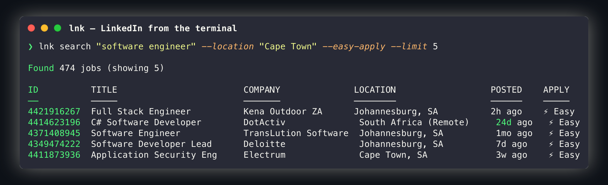

# 🔗 lnk — LinkedIn from the terminal


Search jobs, view profiles, apply — all from your shell. Built on LinkedIn's Voyager API, reverse-engineered from the Android APK.



This uses a private, unofficial API. Automated access can violate LinkedIn's rules
and lead to account restrictions or closure. Request controls reduce accidental
load; they do not authorize automation or provide a safe threshold or ban immunity.
Read [request controls and compatibility](docs/request-compatibility.md) before use.
Applications, saved-job/alert writes, credential changes and logout require explicit
owner consent for the exact action. Discovery is not consent to apply.

## Install

**Homebrew (recommended):**

```bash
brew install yashiels/tap/lnk
```

**Go install:**

```bash
go install github.com/yashiels/linkedin-cli/cmd/lnk@latest
```

**Pre-built binaries:**

Download from the [Releases](https://github.com/yashiels/linkedin-cli/releases) page (macOS arm64/amd64, Linux arm64/amd64).

## Quickstart

```bash
lnk auth login                    # paste your li_at cookie
lnk search "software engineer" --location "Cape Town" --easy-apply
lnk job 4414623196                # view full job details
lnk job 4414623196 --check-apply  # verify the current application route
lnk apply 4414623196 --dry-run    # preview Easy Apply
lnk profile johndoe               # view any profile
lnk feed --limit 10               # recommended jobs
```

## Commands

### auth

Manage LinkedIn session credentials.

```
lnk auth login     Store li_at and JSESSIONID cookies (interactive prompt)
lnk auth status    Show current authentication state
lnk auth logout    Remove stored credentials
```

Credentials are stored in `~/.config/lnk/credentials.json` with `0600` permissions.
You can also supply them via environment variables — see [Configuration](#configuration).

---

### search

Search job postings with powerful filters.

```
lnk search <keywords> [flags]
```

| Flag | Short | Default | Description |
|---|---|---|---|
| `--location` | `-l` | | Location name or geo URN |
| `--type` | `-t` | | Comma-separated job types: `full-time`, `part-time`, `contract`, `temporary`, `volunteer`, `internship` |
| `--experience` | `-e` | | Comma-separated levels: `entry`, `associate`, `mid-senior`, `director`, `executive` |
| `--easy-apply` | | false | Filter for Easy Apply jobs only |
| `--remote` | | false | Filter for remote jobs |
| `--sort` | | `relevant` | Sort order: `recent` or `relevant` |
| `--limit` | `-n` | `25` | Maximum results to return |
| `--posted` | | | Posted within: `24h`, `week`, `month` |

**Examples:**

```bash
lnk search "backend engineer" --location "London" --type full-time --easy-apply
lnk search "product manager" --remote --posted week --sort recent
lnk search "data scientist" --experience entry,mid-senior --limit 50 --json
```

---

### job

View full details for a specific job posting.

```
lnk job <job-id> [flags]
```

| Flag | Description |
|---|---|
| `--open` | Open the job URL in your default browser |
| `--check-apply` | Verify the current application route; may make bounded anonymous GETs to a supported employer ATS URL |

**Example:**

```bash
lnk job 4414623196
lnk job 4414623196 --open
lnk job 4414623196 --check-apply --json
```

Job details include an `application` object while preserving the existing JSON
fields. Its status is deliberately conservative:

| Status | Meaning |
|---|---|
| `accepting` | LinkedIn returned `LISTED`, `onsiteApply: true`, and the exact Easy Apply CTA; or supported employer proof was verified |
| `closed` | LinkedIn returns `CLOSED`/`SUSPENDED`, or Workday JSON returns `jobPostingInfo.canApply: false` |
| `unverified` | No supported proof was available, including missing controls, unsupported ATS destinations, network failures, and login or challenge pages |

`expired: false`, `jobState: LISTED`, an HTTP 200 response, description text that
says “Apply,” or the presence of an employer URL does not mean a job is accepting
applications. `listingUrl` is the LinkedIn listing; `application.applyUrl` is an
employer application URL observed in LinkedIn data. They are never interchangeable.
For the same URL, blank ATS metadata does not replace a real provider. Conflicting
non-empty ATS names remain `unverified`. When LinkedIn returns multiple employer
URLs, one deterministic observed URL is retained without choosing a provider.

`--check-apply` supports narrow proof checks for Lever and Workday. Lever must
return the identified posting's POST application form with an active submission
control inside that form. The control and its ancestors must also be visible by
the supported HTML signals: `hidden`, `aria-hidden=true`, a `hidden` class, or
inline `display:none`/`visibility:hidden`. This is not a complete CSS layout
engine. Workday must return JSON containing a boolean
`jobPostingInfo.canApply`; a normal Workday HTML landing page alone remains
`unverified`. Other ATS destinations remain `unverified` and retain their observed
URL for manual review. Employer checks require HTTPS, use an anonymous client that
does not send LinkedIn credentials, reject non-public destinations and unsafe or
cross-posting redirects, allow at most three redirects, read at most 1 MiB, and
time out after eight seconds.

Lever text such as “deadline passed” or “no longer accepting” is not structured
closure proof. Without a valid active form, Lever remains `unverified`; agents must
check dated deadlines separately in the current description.

---

### apply

Apply to a job via Easy Apply. Known-closed jobs are rejected before the Easy
Apply flow. If Easy Apply is unavailable, `lnk` reports an observed employer URL
as unverified or reports that none was observed; it does not generate an employer
URL from the LinkedIn listing.

```
lnk apply <job-id> [flags]
```

| Flag | Description |
|---|---|
| `--dry-run` | Show what would be submitted without actually applying |
| `--confirm` | Skip the confirmation prompt and apply immediately |

Dry-run is explicit, not the default, and still makes quota-counted live reads.
The default prompts before submission. `--no-input` or a missing TTY without
`--confirm` fails instead of prompting. Agents must preview with `--dry-run` first;
never add `--confirm` automatically or submit without exact owner authorization.

**Examples (submission only with exact owner consent):**

```bash
lnk apply 4414623196 --dry-run    # preview the submission
lnk apply 4414623196              # apply with confirmation prompt
lnk apply 4414623196 --confirm    # apply without prompt
```

## Read-only job verification workflow

For job discovery or a daily scout:

1. Deduplicate search results by the stable job `id`, not title or URL.
2. Run `lnk job <job-id> --check-apply --json` for each candidate.
3. Re-read any closing date in the current description and treat a passed or ambiguous deadline as not apply-now, regardless of status.
4. Put only `application.status == "accepting"` jobs in an apply-now shortlist; keep `unverified` jobs in a separate manual-review list.
5. Assess suitability separately and state qualification or experience gaps explicitly. Application proof says nothing about candidate fit.

This workflow is read-only. Never run `lnk apply`, `lnk saved add/remove`, or
`lnk alerts create/delete` without explicit user consent for that exact write.

---

### saved

Manage your saved jobs.

```
lnk saved list [flags]
lnk saved add <job-id>
lnk saved remove <job-id>
```

| Flag (list) | Default | Description |
|---|---|---|
| `--limit` | `25` | Maximum results to return |

**Examples:**

```bash
lnk saved list
lnk saved list --limit 50 --json
lnk saved add 4414623196
lnk saved remove 4414623196
```

---

### feed

Browse your personalised job recommendations.

```
lnk feed [flags]
```

| Flag | Short | Default | Description |
|---|---|---|---|
| `--limit` | `-n` | `25` | Maximum results to return |

**Example:**

```bash
lnk feed
lnk feed --limit 10 --json
```

---

### profile

View a LinkedIn member profile.

```
lnk profile [username] [flags]
```

Omit `username` to view your own profile. The username is the slug from the LinkedIn
profile URL: `https://www.linkedin.com/in/<username>`

**Examples:**

```bash
lnk profile                        # your own profile
lnk profile satyanadella           # another member's profile
lnk profile yashielsookdeo --json  # output as JSON
```

---

### alerts

Manage LinkedIn job alert subscriptions.

```
lnk alerts list
lnk alerts create [flags]
lnk alerts delete <alert-id>
```

| Flag (create) | Default | Description |
|---|---|---|
| `--keywords` | required | Job search keywords |
| `--location` | | Location filter (city, country, or Remote) |
| `--frequency` | `daily` | Email frequency: `daily` or `weekly` |

**Examples:**

```bash
lnk alerts list
lnk alerts create --keywords "software engineer" --location "Cape Town"
lnk alerts create --keywords "product manager" --location "Remote" --frequency weekly
lnk alerts delete 111222333
```

---

### status

Show authentication state, configuration, and API connectivity. With credentials,
this sends a quota-counted live Ping, then a separate `/me` read on success.
Use `lnk auth status` for local auth state or `lnk safety status` for local policy state.

```
lnk status [flags]
```

```bash
lnk status
lnk status --json
```

---

### completion

Generate shell completion scripts.

```bash
# Bash — source immediately
source <(lnk completion bash)

# Bash — persist across sessions
lnk completion bash > ~/.local/share/bash-completion/completions/lnk

# Zsh
lnk completion zsh > "${fpath[1]}/_lnk"

# Fish
lnk completion fish > ~/.config/fish/completions/lnk.fish

# PowerShell
lnk completion powershell | Out-String | Invoke-Expression
```

---

## Global Flags

These flags work with every command:

| Flag | Short | Description |
|---|---|---|
| `--json` | | Output as JSON (machine-readable) |
| `--plain` | | Output as tab-separated text (pipe-friendly) |
| `--no-color` | | Disable ANSI colour codes |
| `--quiet` | `-q` | Suppress informational messages |
| `--verbose` | | Bounded HTTP method/status diagnostics on stderr |
| `--debug` | | Bounded HTTP method/status diagnostics on stderr; no bodies or URLs |
| `--no-input` | | Fail instead of prompting for input |
| `--config` | | Path to config file (overrides default) |

## Configuration

**Config file:** `~/.config/lnk/config.toml`

```toml
[safety]
delay_seconds = 5
budget = 100

[defaults]
location = "Cape Town, South Africa"
sort     = "relevant"   # or "recent"
limit    = 25

[display]
color = true
```

**Credentials file:** `~/.config/lnk/credentials.json`

**Environment variables:**

| Variable | Description |
|---|---|
| `LNK_LI_AT` | LinkedIn `li_at` session cookie (overrides stored credentials) |
| `LNK_CONFIG` | Path to config file |
| `LNK_CSRF_TOKEN` | CSRF token after `ajax:` in JSESSIONID (overrides stored credentials) |
| `NO_COLOR` | Disable ANSI colour output ([no-color.org](https://no-color.org)) |

Both session values are required. Nonempty cookie environment values override
individual fields loaded from the credentials JSON; an unreadable or invalid file
still fails loading. `--config` overrides `LNK_CONFIG`, which overrides the default
config path; omitted TOML keys use built-ins. `LNK_DEBUG` is not supported.

Safety settings only permit stricter limits: integer `delay_seconds >= 5` (up to
9223371916 seconds) and integer `budget` from 1 to 100. Unknown safety keys fail
with exit 2. Larger delays remain enforced even after the 24-hour admission history
expires. Config paths and cookie changes do not select a new safety namespace.

## How It Works

The API reference was extracted from Android APK v4.1.1209. Requests use RestLi
encoding and session cookies against GraphQL and REST paths under `/voyager/api/`.
The client retains legacy Android-looking 4.1.1209/build 211700 compatibility
headers, but runs Go `net/http` using browser-session cookies. It does not establish
a native Android login. The duplicate tracking `osVersion` key is fixed; that is
header consistency, not proof of current APK identity. A session labeled “Other”
has an opaque UI classification, not a detection verdict.

Working query IDs remain in use. Missing literals in a newer APK audit indicate
possible drift, not server removal or integration of its full catalogue. See
[compatibility limits](docs/request-compatibility.md#session-and-api-compatibility).

## Request controls and recovery

All LinkedIn senders share one host-user-wide in-flight request, at least five
seconds between admissions, and at most 100 admissions per rolling 24 hours by
default. Admissions include reads, writes and connectivity checks; one command can
consume several. These are operational defaults, not LinkedIn-approved thresholds.
Other hosts, apps and older binaries are outside this accounting.

There are no application-layer retries on refusal, transport or body errors.
The first HTTP 429 persists a cooldown of at least 30 minutes or the server's longer
`Retry-After`. HTTP 401/403/999 and known login/challenge redirects persist a manual
stop. A resource 403, expired session, temporary restriction and permanent ban are
different possibilities; the stop does not diagnose which occurred.

```bash
lnk safety status --json
```

This is local and does not read credentials or contact LinkedIn. It creates policy
metadata on first use. After the owner reviews the official app/browser and
explicitly authorizes clearing a manual stop:

```bash
lnk safety resume --confirm --json
```

Resume changes no credentials, cannot shorten cooldown or reset admission history,
and cannot clear an overflow guard or repair corrupt state. Do not delete policy
state to recover budget. State lives at `~/.local/share/lnk/safety`, independent of
`--config` and `LNK_CONFIG`. Read the [state, JSON and recovery contract](docs/request-compatibility.md)
for filesystem requirements, exit codes and remaining limits.

## Disclaimer

Unofficial tool. Not affiliated with, endorsed by, or supported by LinkedIn
Corporation. Use at your own risk. May break if LinkedIn updates their API.
For personal and research use only.

## License

MIT — see [LICENSE](LICENSE).

Copyright (c) 2025 Yashiel Sookdeo
